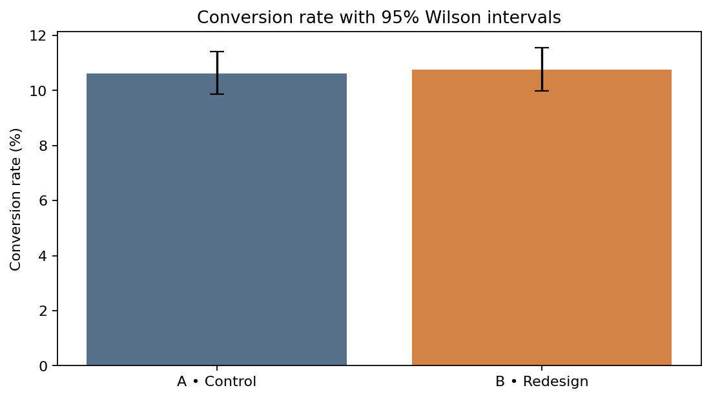

# ShopNext — E-commerce A/B Testing Analysis

**End-to-end product analytics portfolio project | Python, Pandas, SciPy, statsmodels, Matplotlib, Seaborn**

> **Data disclosure:** All ShopNext user and transaction records are **synthetic** and generated for educational/portfolio use. ShopNext is a fictional business. This project does not represent a real production experiment or verified financial impact.

## Business problem

Should an e-commerce company roll out a simplified checkout page (B) instead of the existing checkout (A)? Assess conversion improvement while monitoring revenue per user.

## At a glance

| Metric | A (control) | B (treatment) |
|---|---:|---:|
| Users | 6,000 | 6,000 |
| Conversion rate | 10.62% | 10.75% |
| Revenue per user | 2,230 KZT | 2,125 KZT |

**Observed conversion effect:** +0.13 percentage points (B − A). See the notebook and [executive summary](reports/executive_summary.md) for the statistical uncertainty, QA checks and decision context.



## Questions answered

- Are experiment groups reasonably balanced in size (SRM)?
- Does the new checkout change user conversion? What is the 95% confidence interval for the *difference*?
- What happens to revenue per randomized user and order values?
- Are conclusions robust to extreme transactions?
- How do cumulative metrics evolve, and what are the dangers of peeking?
- How much traffic would a future experiment require for a chosen MDE?

## Methods

- Data-quality validation, user-level deduplication and descriptive statistics
- Hypothesis prioritization with illustrative ICE/RICE scores
- Chi-square SRM diagnostic
- Two-sample z-test for proportions, Wilson and Newcombe confidence intervals
- Welch t-test and non-parametric bootstrap for revenue per user
- IQR diagnostics, P99 cap sensitivity check, segment EDA
- Power analysis for future experimental planning

## Repository layout

```text
.
├── data/
│   ├── shopnext_experiment_raw.csv
│   ├── shopnext_experiment.csv
│   └── hypotheses.csv
├── notebooks/
│   └── ab_testing_analysis.ipynb
├── images/
│   ├── conversion_comparison.png
│   ├── order_value_distribution.png
│   ├── rpu_bootstrap.png
│   └── cumulative_metrics.png
├── reports/
│   └── executive_summary.md
├── requirements.txt
├── .gitignore
└── LICENSE
```

## Reproduce

```bash
python -m venv .venv
# Windows: .venv\Scripts\activate
# macOS/Linux: source .venv/bin/activate
pip install -r requirements.txt
jupyter notebook notebooks/ab_testing_analysis.ipynb
```

Run the notebook from top to bottom. It discovers `data/` from either the repository root or the `notebooks/` directory and regenerates all figures.

## Limitations

This is a portfolio simulation, not a production case. The analysis cannot validate traffic-source representativeness or a true rollout impact. No pre-registered sequential test, non-inferiority bound or economic forecasting assumption is supplied. Segment differences are exploratory, not causal subgroup claims. Interpret significance, effect size and uncertainty jointly.

## Inspiration and credits

- Original methodological inspiration: [syuzannepetrosyan/a-b-tests](https://github.com/syuzannepetrosyan/a-b-tests) (hypothesis prioritization, A/B analysis and cumulative metrics).
- ShopNext datasets, notebook, text and charts in this repository are newly authored for this project; do not imply the original author created or endorsed ShopNext.

## How to present this project in an interview

1. State the **business decision** before the choice of test.
2. Explain the **randomization unit** and experiment validity checks.
3. Report **effect sizes and confidence intervals**, not just p-values.
4. Separate **primary decisions** from exploratory and sensitivity analyses.
5. Disclose that the dataset is synthetic and describe what would change for a real launch.
